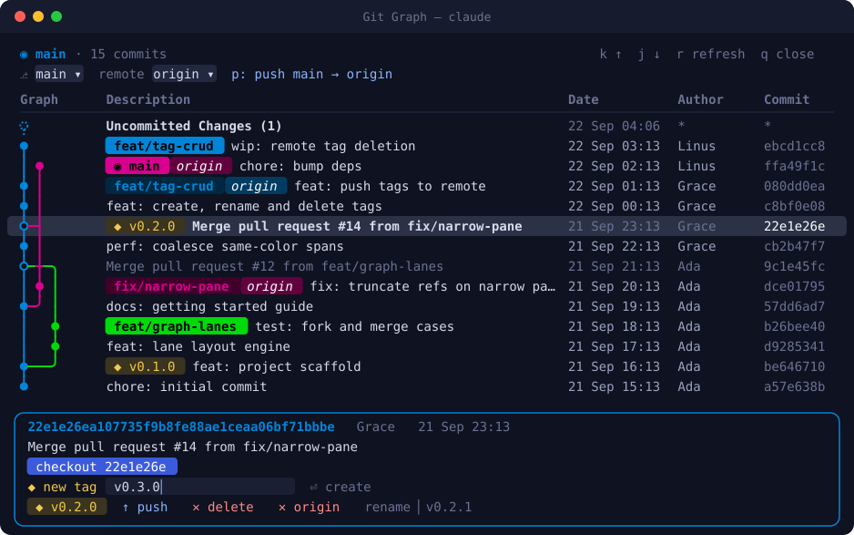

<p align="center">
  
</p>

<h1 align="center">Git Graph for Claude Code</h1>

<p align="center">
  <b>ブランチをひと目で把握。Claude Code から離れずに切り替え・タグ付け・プッシュ。</b><br>
  <a href="https://github.com/mhutchie/vscode-git-graph">vscode-git-graph</a> スタイルのコミットグラフを、会話の横のペインに表示します。
</p>

<p align="center">
  <a href="README.md">English</a> · <a href="README.zh-TW.md">繁體中文</a> · <b>日本語</b>
</p>

<p align="center">
  
</p>

## なぜ Git Graph？

Claude はコードを編集し、`git` も実行してくれます。でもターミナルで見える履歴は一度に一行だけ。Git Graph は全体像を画面に広げます。色分けされたレーン、マージ、ブランチ、リモート、タグまで見渡せて、どのコミットもワンキーで操作できます。

- **本物のレーンレイアウト**：ブランチごとに色が付き、マージや分岐はなめらかな曲線で描かれます。ASCII の寄せ集めではありません。
- **ref をピル表示**：ローカルブランチは同名の `origin` ブランチとひとつにまとめて表示。`◉` は HEAD、`◆` はタグを示し、リモートにしかないブランチもひと目で分かります。
- **読みやすい表**：Graph・Description・Date・Author・Commit の 5 列構成。マージコミットは淡色で表示し、未コミットの変更は先頭に固定されます。
- **自動で同期**：Claude が `git` コマンドを実行するたびにグラフが更新されます。
- **狭いペインにも対応**：長い ref 名は短縮され、幅が足りないときは補助列が自動で隠れます。

## できること

| | 操作 | 方法 |
|---|---|---|
| ⎇ | **任意のブランチ**へ切り替え（ローカル／リモートのみ） | ヘッダーのブランチ選択。リモートにしかないブランチは `git switch --track` で自動的に追跡ブランチを作成 |
| ⎋ | **任意のコミット**をチェックアウト | コミットを選択 → `checkout <hash>`（detached HEAD） |
| ◆ | タグを**作成** | コミットを選択 → `◆ new tag` に名前を入力 → Enter |
| ◆ | タグを**リネーム** | タグ行の `rename` 欄。注釈付きタグはメッセージを引き継ぎます |
| ✕ | タグを**削除**（ローカル／リモート） | `✕ delete`／`✕ origin`。2 回押して確定 |
| ↑ | ブランチとタグを**プッシュ** | `p` で現在のブランチをプッシュ（`-u` 付き）。各ブランチ・タグに `↑ push`。プッシュ先のリモートはヘッダーで選択 |

## インストール

```sh
claude plugin marketplace add cainmaila/claude-code-git-graph
claude plugin install git-graph@git-graph
```

あとはどの Claude Code セッションでも次を入力するだけです。

```
/git-graph
```

すでに開いているセッションでは、先に `/reload-plugins` を実行してください。

## キー操作

| キー | 動作 |
|---|---|
| `j` / `k` | 選択を下／上へ移動 |
| ハッシュをクリック | そのコミットを選択／選択解除 |
| `p` | 現在のブランチを選択中のリモートへプッシュ |
| `r` | 再読み込み |
| `x` | コミット詳細を閉じる |
| `q` / `Esc` | ペインを閉じる |

## 安全性

- すべての git コマンドは引数をそのまま git に渡して実行し、シェル文字列を組み立てることはありません。
- タグ名は `git check-ref-format` で検証し、`-` で始まる名前は拒否します。
- 破壊的な操作（ローカル／リモートのタグ削除）は 2 回押さないと実行されません。
- プッシュ時にパスワード入力待ちで止まることはありません（`GIT_TERMINAL_PROMPT=0`）。SSH 鍵か credential helper を設定してください。
- force push、reset、rebase、ブランチ削除は行いません。Git Graph が履歴を書き換えることはありません。

## 動作要件

- プラグイン関数フック（mods）に対応した Claude Code 2.1.291 以降
- `PATH` から実行できる `git`

## 開発

```sh
git clone git@github.com:cainmaila/claude-code-git-graph.git
claude --plugin-dir ./claude-code-git-graph   # 編集するとホットリロード
claude plugin test ./claude-code-git-graph    # レーンレイアウトとペイン描画のテスト
claude plugin validate ./claude-code-git-graph
```

| ファイル | 役割 |
|---|---|
| `hooks/register.tsx` | コマンド、ペイン描画、git 操作 |
| `hooks/graph.ts` | `git log` の解析とレーンレイアウトのアルゴリズム |
| `types/index.d.ts` | ペイン状態の型定義 |

## ライセンス

[MIT](LICENSE)

## アンインストール

```sh
claude plugin uninstall git-graph@git-graph
```

---

<p align="center"><a href="https://github.com/mhutchie/vscode-git-graph">mhutchie/vscode-git-graph</a> にインスパイアされ、Claude Code mod として作られました</p>
